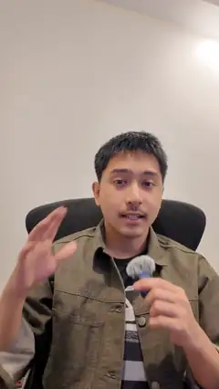
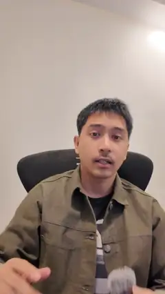
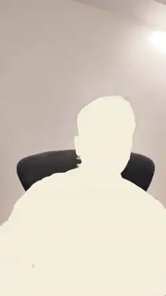

# facecammaxxing

Pro motion-graphics effects on your own talking-head clip, as a Claude Code skill. Remotion + GSAP + Three.js render the
effects over a clean cut-out of you (RobustVideoMatting), so words, cards, 3D rings and Blender-modelled props sit **behind your
head** or float in front of you, track your face, and stay out of the Reels UI. It works like an award-level reel director:
brief, one idea per sentence, a beat plan, the hardest beat first, and a measured self-review (`docs/director.md`).

> **Based on [claude-video-effects](https://github.com/Vibha-Ramprakash/claude-video-effects) by Vibha Ramprakash
> ([@vibha.in.progress](https://instagram.com/vibha.in.progress)).** The idea of a drop-in-your-clip effects skill for Claude
> Code, many of the effect concepts and names, and the look of the ChatRender intro and the comment-keyword ending come from
> her repo and reels. This version rebuilds the pipeline on Remotion, GSAP and Three.js. Her work is MIT licensed; its notice
> is kept in [LICENSE](LICENSE). Go give her a follow 💛

```bash
bash install.sh                                   # link into ~/.claude/skills/facecammaxxing
.venv/bin/python scripts/fcm.py setup             # venv, models, Remotion (prints READY)
.venv/bin/python scripts/fcm.py track clip.mp4 job
.venv/bin/python scripts/fcm.py check job plan.json
.venv/bin/python scripts/fcm.py render job plan.json --out final.mp4
.venv/bin/python scripts/fcm.py blender job my_prop.py --name mic   # optional: model a 3D prop in headless Blender
```

## The effect library

22 effects, all equal: one library, grouped only by the job each does in a beat. Every preview below is a real render on the same
6.8 s DJI clip; click one for the MP4, or the name for the plan that made it (`examples/<fx>.json`). Numbers, names and tier-list
items on screen are examples: pass your own.

### Proof and numbers
<table>
<tr><td align="center" valign="top" width="25%"><a href="demo/over-the-shoulder.mp4"></a><br><a href="examples/over-the-shoulder.json"><code>over-the-shoulder</code></a><br><sub>Camera pushes over each shoulder to Before / After cards</sub></td><td align="center" valign="top" width="25%"><a href="demo/kallaway-split.mp4"></a><br><a href="examples/kallaway-split.json"><code>kallaway-split</code></a><br><sub>The clip drops into a card; your numbers rise behind your head</sub></td><td align="center" valign="top" width="25%"><a href="demo/glass-graph.mp4"></a><br><a href="examples/glass-graph.json"><code>glass-graph</code></a><br><sub>Frosted card, the number counts up, an orange line draws</sub></td><td align="center" valign="top" width="25%"><a href="demo/glass-widgets.mp4"></a><br><a href="examples/glass-widgets.json"><code>glass-widgets</code></a><br><sub>Glass stat, graph, follow card and pill around your head</sub></td></tr>
<tr><td align="center" valign="top" width="25%"><a href="demo/tier-list.mp4"></a><br><a href="examples/tier-list.json"><code>tier-list</code></a><br><sub>An S-D tier list builds under your chin</sub></td></tr>
</table>

### Type and captions
<table>
<tr><td align="center" valign="top" width="25%"><a href="demo/text-behind.mp4"></a><br><a href="examples/text-behind.json"><code>text-behind</code></a><br><sub>A huge word rises from behind your body</sub></td><td align="center" valign="top" width="25%"><a href="demo/backdrop-word.mp4"></a><br><a href="examples/backdrop-word.json"><code>backdrop-word</code></a><br><sub>A giant word drops in behind you, letter by letter</sub></td><td align="center" valign="top" width="25%"><a href="demo/kinetic-caption.mp4"></a><br><a href="examples/kinetic-caption.json"><code>kinetic-caption</code></a><br><sub>Word-by-word captions, top line tucked behind your head</sub></td></tr>
</table>

### Camera, light and look
<table>
<tr><td align="center" valign="top" width="25%"><a href="demo/lean-in.mp4"></a><br><a href="examples/lean-in.json"><code>lean-in</code></a><br><sub>A hard punch-in on one word, with motion blur and depth of field</sub></td><td align="center" valign="top" width="25%"><a href="demo/slow-push.mp4"></a><br><a href="examples/slow-push.json"><code>slow-push</code></a><br><sub>A slow push-in with real parallax; the room melts soft</sub></td><td align="center" valign="top" width="25%"><a href="demo/spotlight.mp4"></a><br><a href="examples/spotlight.json"><code>spotlight</code></a><br><sub>Lights down, you lit with a warm rim, a glowing word</sub></td><td align="center" valign="top" width="25%"><a href="demo/color-grade.mp4"></a><br><a href="examples/color-grade.json"><code>color-grade</code></a><br><sub>Flat LOG look wiped into a cinematic grade</sub></td></tr>
<tr><td align="center" valign="top" width="25%"><a href="demo/grade.mp4"></a><br><a href="examples/grade.json"><code>grade</code></a><br><sub>A colour grade on you and the room</sub></td><td align="center" valign="top" width="25%"><a href="demo/locked-on.mp4"></a><br><a href="examples/locked-on.json"><code>locked-on</code></a><br><sub>Brackets snap onto your face and the camera follows</sub></td></tr>
</table>

### 3D and depth
<table>
<tr><td align="center" valign="top" width="25%"><a href="demo/prop-3d.mp4"></a><br><a href="examples/prop-3d.json"><code>prop-3d</code></a><br><sub>A Blender-modelled prop lands beside your head, lit like the room</sub></td><td align="center" valign="top" width="25%"><a href="demo/carousel-spin.mp4"></a><br><a href="examples/carousel-spin.json"><code>carousel-spin</code></a><br><sub>Your reels spin around you in a 3D carousel</sub></td><td align="center" valign="top" width="25%"><a href="demo/orbit.mp4"></a><br><a href="examples/orbit.json"><code>orbit</code></a><br><sub>Your reels orbit your head, behind you and in front</sub></td></tr>
</table>

### People, openers and framing
<table>
<tr><td align="center" valign="top" width="25%"><a href="demo/freeze-frame.mp4"></a><br><a href="examples/freeze-frame.json"><code>freeze-frame</code></a><br><sub>Freeze, the room greys, a sticker outline and a name tag</sub></td><td align="center" valign="top" width="25%"><a href="demo/name-tag.mp4"></a><br><a href="examples/name-tag.json"><code>name-tag</code></a><br><sub>A lower-third name tag slides in from the edge</sub></td><td align="center" valign="top" width="25%"><a href="demo/silhouette-intro.mp4"></a><br><a href="examples/silhouette-intro.json"><code>silhouette-intro</code></a><br><sub>Opens on a flat silhouette, then the footage cuts in</sub></td><td align="center" valign="top" width="25%"><a href="demo/window-cards.mp4"></a><br><a href="examples/window-cards.json"><code>window-cards</code></a><br><sub>Retro windows of your reels; a cursor clicks one</sub></td></tr>
<tr><td align="center" valign="top" width="25%"><a href="demo/bottom-fade.mp4"></a><br><a href="examples/bottom-fade.json"><code>bottom-fade</code></a><br><sub>The bottom fades dark so captions and tags read</sub></td></tr>
</table>

### Intro
<table>
<tr><td align="center" valign="top" width="25%"><a href="demo/chat-render.mp4"></a><br><a href="examples/chat-render.json"><code>ChatRender</code></a><br><sub>A 2.5 s chat intro: the command is typed and sent, then dots resolve into the effect</sub></td></tr>
</table>

Any plan can open with it: add `"intro": {"command": "/glass-graph", "description": "A glass card with a graph that climbs"}`, or
pass `--intro` to `fcm render`.

### Effects together
<table>
<tr><td align="center" valign="top" width="25%"><a href="demo/editorial-hook.mp4"></a><br><a href="examples/editorial-hook.json"><code>editorial-hook</code></a><br><sub>Captions behind the head, retro windows, two punch-ins</sub></td><td align="center" valign="top" width="25%"><a href="demo/podcast-hook.mp4"></a><br><a href="examples/podcast-hook.json"><code>podcast-hook</code></a><br><sub>Silhouette open, name tag, small lead-in over a big word</sub></td></tr>
</table>

See `SKILL.md` for the workflow, `docs/director.md` for how to direct it and `docs/motion-rules.md` for the motion and layout
rules every effect follows.

Needs: macOS or Linux, ffmpeg, Python 3.10-3.12 (or uv), Node 22+. Optional: Blender 3.6+ (or `pip install bpy` on Python 3.11)
for new 3D props; the built-in ones ship in `props/`.
